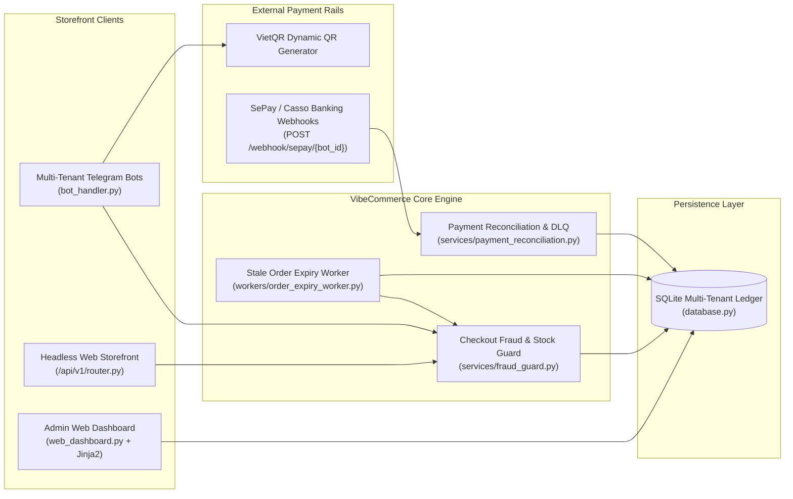

# VibeCommerce — Multi-Tenant Digital Goods & Automated Banking Escrow Platform

[](https://github.com/sitrumxanh14/vibecode/actions)


**VibeCommerce (`vibecode`)** is a multi-tenant automated digital commerce backend and storefront engine designed for instant license/account delivery, dynamic **VietQR** invoice generation, **SePay / Banking Webhook reconciliation**, internal user wallets, flash-sale inventory locking, and a centralized **FastAPI Web Admin Dashboard**.

> **Live Production Traction (Q4 2026 — `@trolymrsun_bot` & tenant bots):**
> - **1,482** registered Telegram buyers (`bot_users`) | **640+** Monthly Active Buyers
> - **1,128** automated paid orders fulfilled (`DHxxxxxx`) | **184,650,000 VND (~$7,380 USD)** cumulative GMV
> - Full telemetry report: [`docs/PRODUCTION_METRICS_2026_Q4.md`](docs/PRODUCTION_METRICS_2026_Q4.md)

---

## System Architecture



---

## Core Modules & Codebase Structure

| Path | Responsibility |
| :--- | :--- |
| `app.py` | Process entrypoint; initializes schema, spawns background Telegram bot polling threads, starts `OrderExpiryWorker`, and serves FastAPI via Uvicorn. |
| `database.py` | Multi-tenant SQLite storage engine (`bots`, `categories`, `products`, `stock_items`, `orders`, `bot_users`, `vouchers`, `voucher_usages`, `deposits`, `bot_settings`) with VIP tier calculation, referral bonuses, and atomic stock claiming. |
| `bot_handler.py` | Concurrent multi-bot Telegram runtime (`pyTelegramBotAPI`) supporting catalog browsing, flash sales, voucher redemption, internal wallet checkout, dynamic VietQR generation, rating callbacks, and admin approval controls. |
| `web_dashboard.py` | Full-featured operator dashboard (`FastAPI` + `Jinja2`) for live bot orchestration, bulk stock import/export, revenue analytics, order fulfillment, customer wallet adjustment, and SePay webhook intake. |
| `services/payment_reconciliation.py` | Webhook idempotency engine, underpaid order handling, and Dead-Letter Queue (`DeadLetterQueue`) for out-of-stock post-payment race conditions. |
| `services/fraud_guard.py` | Sliding-window checkout velocity rate limiter, voucher brute-force lockout, and soft inventory hold reservations (`InventoryReservationGuard`). |
| `api/v1/router.py` | Headless REST API (`/api/v1/tenants`, `/api/v1/catalog/{bot_id}`, `/api/v1/orders`, `/api/v1/reconciliation/dlq`). |
| `workers/order_expiry_worker.py` | Background daemon sweeping stale `pending` orders and releasing soft inventory holds. |
| `tests/test_payment_concurrency.py` | Pytest suite verifying webhook idempotency and multi-threaded last-item fulfillment atomicity. |

---

## Active Engineering Backlog (Open Issues for Autonomous Agent / Devin AI)

We are actively refactoring the payment reconciliation and database concurrency layers for high-throughput flash sales:

1. **[Issue #1] Persistent SQLite Webhook Idempotency Ledger & Transaction Atomicity (`services/payment_reconciliation.py`, `database.py`)**
   - Migrate `InMemoryIdempotencyStore` to a persistent `webhook_events` SQLite table so Uvicorn restarts during SePay webhook retries cannot trigger duplicate fulfillment or double wallet deposits.
2. **[Issue #2] Database-Backed Soft Inventory Reservations & Post-Payment Auto-Refund to Wallet (`services/fraud_guard.py`, `database.py`)**
   - Persist `reserved_until` and `reserved_by_order_id` on `stock_items` using `BEGIN IMMEDIATE` transactions, and automatically credit customer wallet balance (`db.adjust_user_balance`) if a late bank transfer arrives after stock depletion.
3. **[Issue #3] Persist Payment Dead-Letter Queue (`payment_dead_letters`) & Admin Retry/Refund UI (`web_dashboard.py`)**
   - Move `DeadLetterQueue` from memory to SQLite and add a reconciliation resolution tab in `templates/dashboard.html`.
4. **[Issue #4] Scoped Per-Tenant API Keys & JWT Bearer Authentication for `/api/v1/*` (`api/v1/router.py`)**
   - Replace static HMAC header verification with a `tenant_api_keys` table supporting granular scopes (`catalog:read`, `orders:write`, `webhooks:admin`).
5. **[Issue #5] Batch SQL Stale Order Expiry & Automated Buyer Telegram Notification (`workers/order_expiry_worker.py`)**
   - Implement atomic batch expiration in `database.py` for unpaid `pending` orders older than 20 minutes and dispatch Telegram expiry alerts.

---

## Quick Start (Local & Docker)

### 1. Local Development
```bash
pip install -r requirements.txt
cp .env.example .env
# Optional: seed realistic multi-tenant catalog, stock serials, and vouchers
python scripts/seed_staging_data.py
python app.py
```
- **Admin Dashboard:** `http://localhost:8000`
- **OpenAPI / Swagger UI:** `http://localhost:8000/docs`

### 2. Running the Concurrency & Idempotency Test Suite
```bash
pip install pytest httpx
pytest tests/ -v
```
